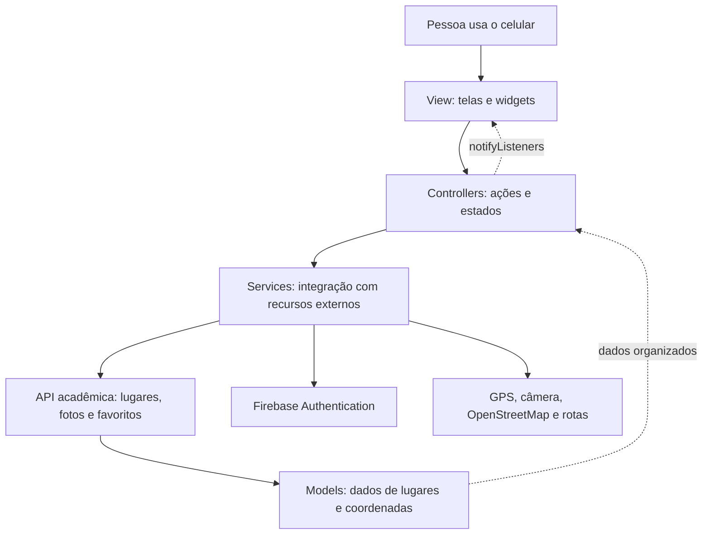
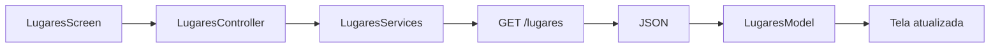
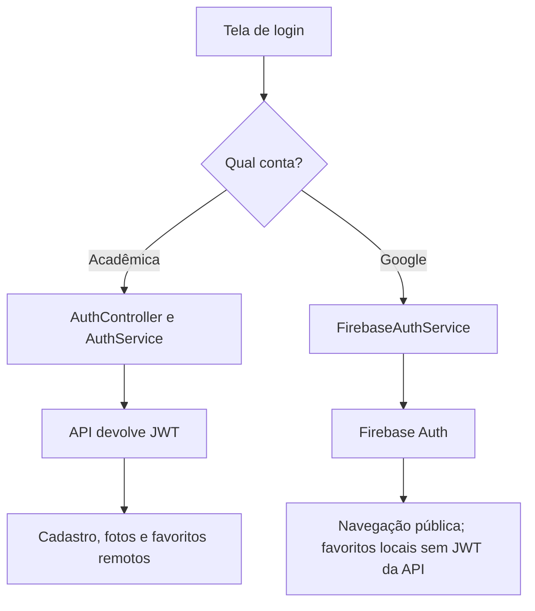
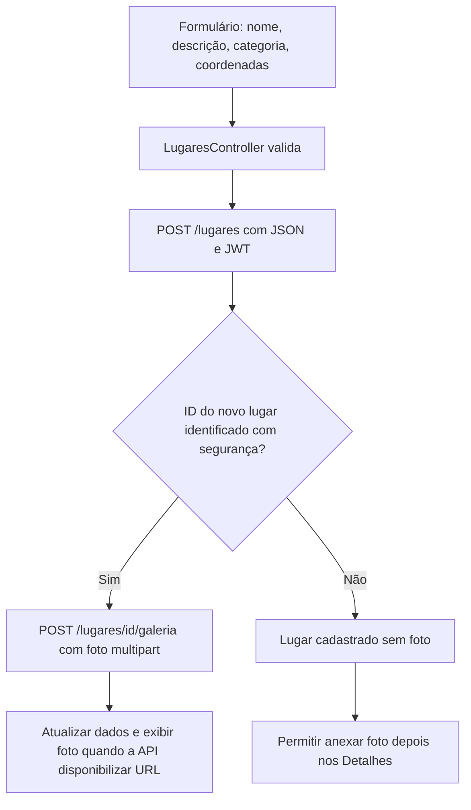
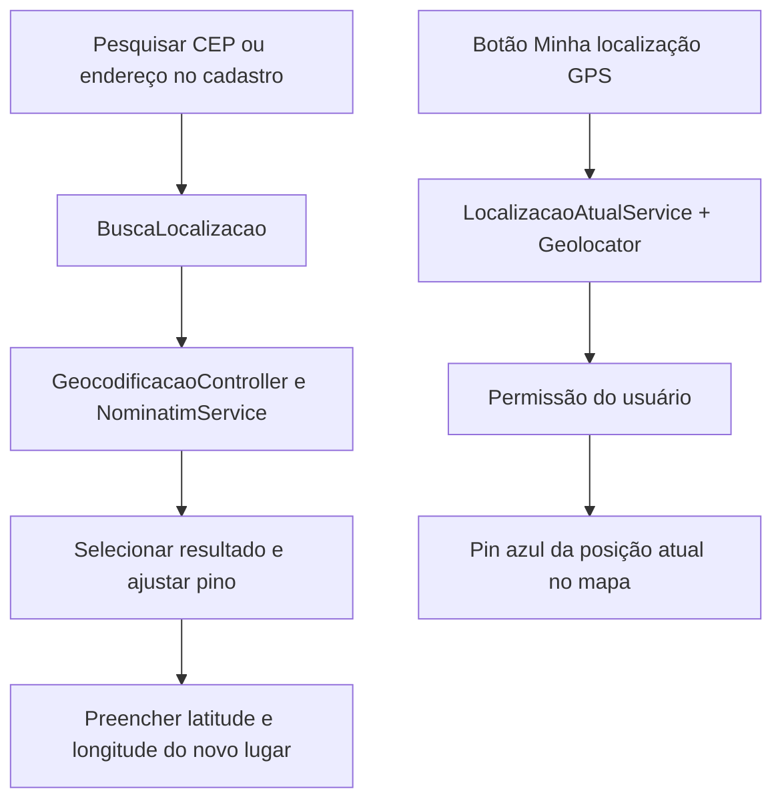
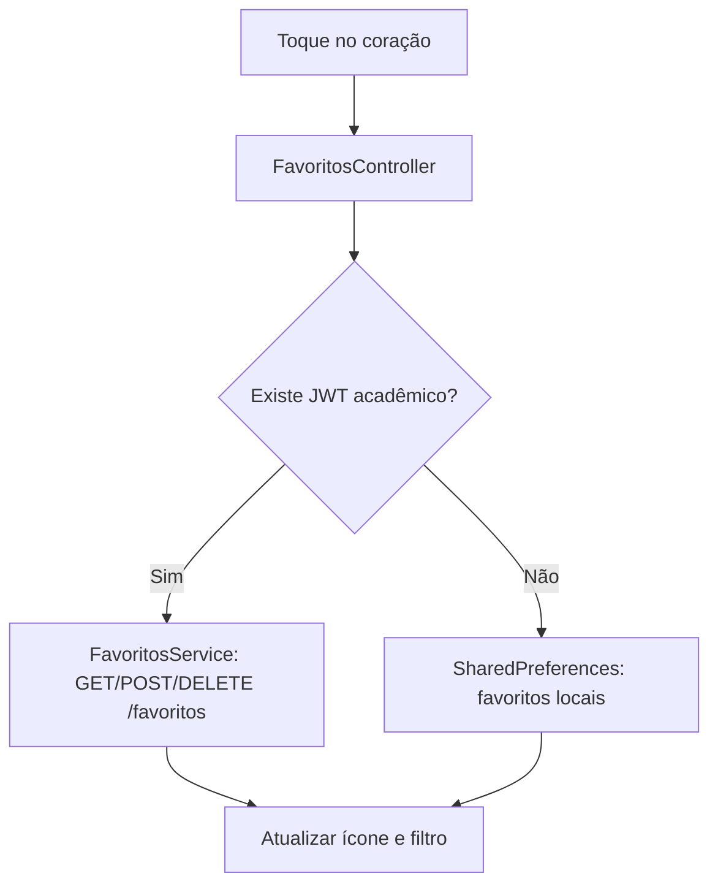
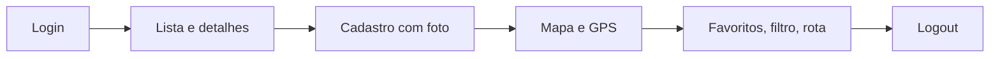

# Explore Turismo — Guia de arquitetura e MVC para apresentação

> Mobile II · Flutter/Dart · Base: branch `feat/entrega-final-mobile2` (24/11/2026).
>
> Esquemas didáticos, não capturas do aplicativo em execução. A versão ilustrada completa também foi preparada em Word e PDF para estudo.

## 1. O que o aplicativo faz

O Explore Turismo consulta os lugares cadastrados na API acadêmica, mostra fotos e detalhes quando disponíveis e permite cadastro com foto, busca por CEP/endereço, mapa OpenStreetMap, localização GPS, favoritos, filtro e abertura de rotas. O Firebase oferece autenticação Google, mas a API acadêmica utiliza seu **próprio JWT**, necessário para escrever dados.

## 2. Como o código é separado



O app segue uma **organização inspirada no MVC**, ampliada com Services e Provider/ChangeNotifier:

| Parte | Pastas principais | O que faz |
|---|---|---|
| Model | `lib/models/` | Representa os dados recebidos e enviados, como lugares e coordenadas. |
| View | `lib/screens/`, `lib/widgets/`, `lib/themes/` | Mostra telas, botões, mapa, fotos e mensagens. |
| Controller | `lib/controllers/` | Recebe ações, gerencia carregamento, erros e atualização da tela. |
| Services | `lib/services/` | Faz chamadas HTTP e usa Firebase, GPS, câmera e armazenamento. |
| Provider | configurado em `lib/main.dart` | Compartilha controllers e ajuda a atualizar widgets com `notifyListeners()`. |

O padrão **não é apenas separar arquivos em três pastas**; cada parte precisa desempenhar sua responsabilidade. A teoria é explicada nas notas de aula DS II, seção 8, pp. 43–58, fornecidas como referência conceitual.

## 3. Mapa de pastas

```text
lib/
├── main.dart                  Início, rotas e Provider
├── firebase_options.dart      Configuração do Firebase Android
├── models/                   Estrutura de lugares e localizações
├── screens/                  Login, Home, Lugares, Mapa, Detalhes, Câmera
├── widgets/                  Busca de localização e foto de lugar
├── controllers/              Login, lugares, favoritos, CEP, câmera, tema
├── services/                 API, Firebase, GPS, sessão, fotos e rotas
├── themes/                   Tema claro/escuro
└── controller/               Reexports para compatibilidade com código antigo
test/                          Testes automatizados
```

A pasta antiga `lib/controller/` **não é uma segunda implementação**: seus seis arquivos apenas reexportam os controllers atuais.

## 4. Da tela até a API: consulta de lugares



A tela pede os lugares; o controller organiza a solicitação; o service consulta a API; o model converte os dados e a View mostra a lista. **JSON é formato de transporte**, não um banco de dados nem um substituto do Model.

## 5. Login Google e login acadêmico



A autenticação Google não passa automaticamente a dar acesso à escrita na API da disciplina. `SessionService` cuida da sessão acadêmica, e `FavoritosController` ajuda a não misturar estados de contas diferentes.

## 6. Cadastro de lugar com foto



A foto é **uma segunda operação**, depois de criar o registro. O campo enviado no multipart é `foto`. Se não houver um ID único e seguro, o app não deve anexar a imagem a um lugar incerto. O retorno real da foto na API ainda precisa de validação física.

## 7. CEP e GPS não são a mesma coisa



- **CEP/endereço:** encontra um ponto aproximado para o formulário e permite ajustar o marcador.
- **GPS:** consulta a posição atual do aparelho, mediante permissão, e pode indicar a distância a um destino.
- **OpenStreetMap:** fornece o mapa de fundo usado pelo `flutter_map`.
- **Como chegar:** abre uma navegação externa pelo Google Maps.

## 8. Favoritos



O Controller limpa os favoritos visíveis ao trocar de conta e ignora respostas de operações antigas, para evitar que uma conta veja os favoritos da anterior.

## 9. Conexão dos arquivos principais

| Módulo | Arquivos | Ligação |
|---|---|---|
| Inicialização | `main.dart` | Configura Flutter, Firebase, Provider e rotas. |
| Login | `screens/login_screen.dart`, `controllers/auth_controller.dart`, `services/auth_service.dart`, `services/firebase_auth_service.dart` | View → Controller / Service → API ou Firebase. |
| Sessão | `services/session_service.dart`, `services/navegacao_service.dart` | Armazena/encerra sessão acadêmica e direciona ao login. |
| Lugares | `screens/cadastro_lugar.dart`, `controllers/lugares_controller.dart`, `services/lugares_services.dart`, `models/lugares_model.dart` | Tela → Controller → HTTP → Model → Tela. |
| Fotos | `screens/camera_screen.dart`, `services/camera_service.dart`, `services/galeria_service.dart`, `widgets/lugar_foto.dart` | Captura, envia e exibe foto. |
| Detalhes | `screens/detalhe_lugar_screen.dart` | Usa Model, favoritos, galeria e rotas. |
| Mapa | `screens/mapa_screen.dart`, `services/localizacao_atual_service.dart`, `services/rotas_service.dart` | Pinos, GPS, distância e navegação. |
| Busca CEP | `widgets/busca_localizacao.dart`, `controllers/geocodificacao_controller.dart`, `services/geocodificacao_service.dart`, `screens/selecionar_localizacao_screen.dart` | Busca → resultados → pino → formulário. |
| Favoritos | `controllers/favoritos_controller.dart`, `services/favoritos_service.dart` | Remoto com JWT ou local sem JWT. |
| Tema | `controllers/theme_controller.dart`, `themes/themes_widget.dart` | Alteração do visual claro/escuro. |

## 10. Roteiro de demonstração



**Como explicar:** “Nós separamos o código para cada parte ter sua função. A tela apresenta e recebe ações; o controller coordena; os models organizam os dados; e os services conversam com a internet e com recursos do celular.”

Os testes usam respostas simuladas, então **não substituem** validação de câmera, login Google, GPS, fotos, favoritos e rotas no dispositivo. O PR #3 permanece em rascunho, sem merge na `main`, até essa revisão.

## Material consultado

- `README.md` e `ENTREGA_FINAL.md` desta branch.
- Código Dart atual do Explore Turismo.
- Notas de aula DS II, seções 8.3–8.17 (pp. 43–58), para conceitos de MVC, JSON e camadas. O exemplo de Node.js da apostila é de outro sistema e foi apenas adaptado conceitualmente.
